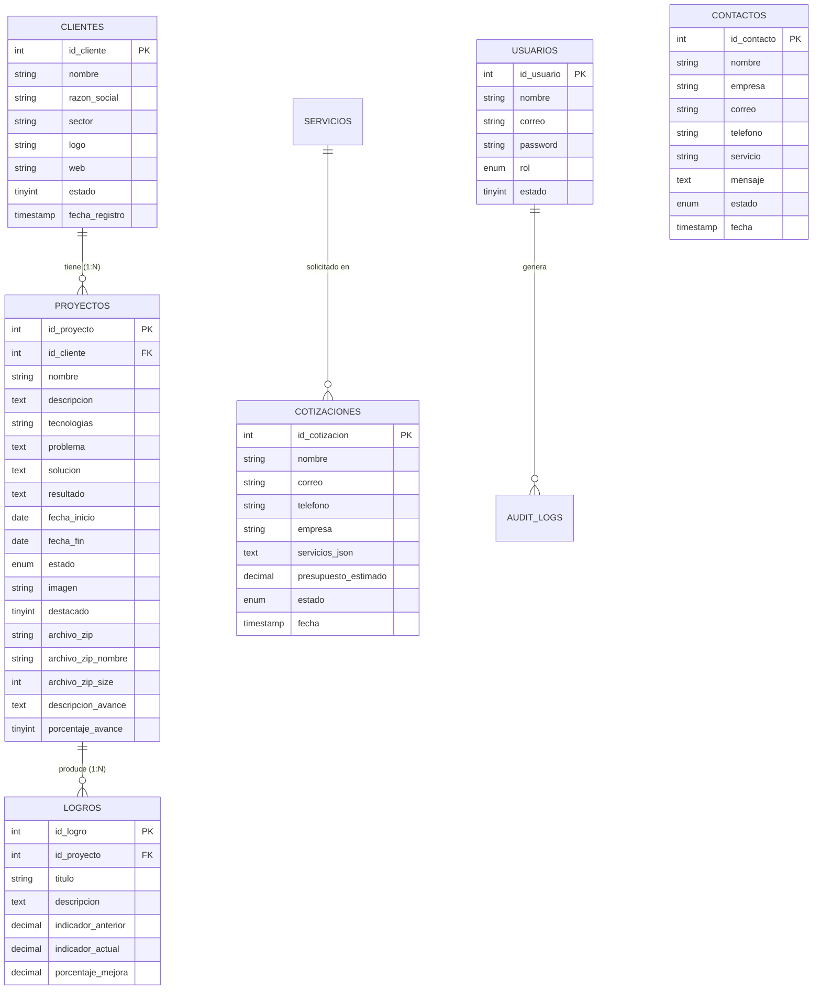

# 🚀 DEVIOZ PROYECTOS — Plataforma Web Corporativa & Panel Administrativo

> **Aplicación Web Full Stack** para consultoría tecnológica empresarial, orientada a exhibir servicios, clientes corporativos, proyectos de transformación digital, logros con métricas de impacto y gestión administrativa integral con control de entregables (.ZIP) y pipeline en tiempo real.

[](https://www.php.net/)
[](https://www.mysql.com/)
[](https://getbootstrap.com/)
[](https://developer.mozilla.org/)
[](#)

---

## 📑 Tabla de Contenidos

1. [Visión General del Sistema](#-visión-general-del-sistema)
2. [Arquitectura Tecnológica & Stack](#-arquitectura-tecnológica--stack)
3. [Estructura del Proyecto](#-estructura-del-proyecto)
4. [Modelo de Datos & Relaciones (BD)](#-modelo-de-datos--relaciones-bd)
5. [Módulos del Sistema](#-módulos-del-sistema)
   * [Frontend Público](#1-portal-público-institucional)
   * [Panel Administrativo (CMS / ERP)](#2-panel-administrativo-admin)
   * [Gestión de Avances y Entregables ZIP](#3-módulo-de-entregables-zip-y-seguimiento-de-avances)
   * [Dashboard en Tiempo Real & Business Intelligence](#4-dashboard-ejecutivo-en-tiempo-real)
6. [Seguridad y Buenas Prácticas](#-seguridad-y-buenas-prácticas)
7. [Instalación y Despliegue Local (XAMPP)](#-instalación-y-despliegue-local-xampp)
8. [Credenciales por Defecto](#-credenciales-por-defecto)
9. [Guía para Nuevos Desarrolladores (Onboarding)](#-guía-para-nuevos-desarrolladores-onboarding)

---

## 🎯 Visión General del Sistema

**Devioz Proyectos** resuelve dos necesidades críticas en una consultora tecnológica:

1. **Área Pública (Showcase & Captación):** Posicionamiento de marca, visualización del catálogo de servicios, cartera de clientes (BCP, Claro, Molitalia, AJE, etc.), casos de éxito con evidencia visual y solución desarrollada, cotizador dinámico en línea y formulario de contacto.
2. **Área Administrativa (Gestión Operativa):** Plataforma protegida con roles donde el equipo administra clientes, proyectos, hitos porcentuales, paquetes comprimidos entregables (`.zip`, `.rar`), bitácora de logros, solicitudes de contacto y cotizaciones con KPIs comerciales.

---

## 🛠 Arquitectura Tecnológica & Stack

### Backend
* **Lenguaje:** PHP 8.x (Programación Modular estructurada con PDO nativo).
* **Base de Datos:** MySQL / MariaDB (Motor InnoDB con claves foráneas e integridad referencial en cascada).
* **Conexión:** Patrón Singleton / Instancia estática PDO con manejo de excepciones `PDOException` y emulación de prepares desactivada (`PDO::ATTR_EMULATE_PREPARES => false`).
* **Autenticación:** Sesiones nativas PHP seguras con validación `password_hash()` (algoritmo BCRYPT) y control de acceso centralizado (`includes/auth-check.php`).

### Frontend
* **HTML5 Semántico** y **CSS3 Moderno** (Variables CSS, Glassmorphism, temas oscuros de alto contraste).
* **Bootstrap 5.3.2** (Sistema de Grid responsivo adaptado a Mobile, Tablet y Desktop Ultra-Wide).
* **Vanilla JavaScript ES6+** (Sin frameworks pesados, manipulación reactiva del DOM, Fetch API asíncrono para Live Polling).
* **Librerías Visuales:**
  * [Chart.js 4.4](https://www.chartjs.org/) (Gráficos interactivos de barras y donas para Business Intelligence).
  * [Bootstrap Icons 1.11](https://icons.getbootstrap.com/) (Iconografía del sistema).

### Entorno y Servidor
* **Servidor Web:** Apache 2.4 (XAMPP).
* **Entorno de Ejecución:** PHP 8.2+ con módulos `pdo_mysql`, `fileinfo`, `mbstring` activos.

---

## 📂 Estructura del Proyecto

```text
Proyecto_Servicios/
├── admin/                               # Panel de Control Administrativo
│   ├── auditoria/                       # Registro de auditoría y logs de actividad
│   ├── clientes/                        # CRUD de Clientes Corporativos
│   │   ├── crear.php
│   │   ├── editar.php
│   │   ├── eliminar.php
│   │   ├── listar.php
│   │   └── toggle-estado.php            # Toggle AJAX activo/inactivo
│   ├── contactos/                       # Bandeja de Mensajes de Contacto
│   │   ├── cambiar-estado.php
│   │   ├── eliminar.php
│   │   ├── listar.php
│   │   └── ver.php
│   ├── cotizaciones/                    # Gestión del Pipeline Comercial
│   │   ├── cambiar-estado.php
│   │   ├── eliminar.php
│   │   ├── exportar-pdf.php
│   │   └── listar.php
│   ├── logros/                          # CRUD de Logros & Métricas de Impacto
│   │   ├── crear.php
│   │   ├── editar.php
│   │   ├── eliminar.php
│   │   └── listar.php
│   ├── proyectos/                       # CRUD de Proyectos & Entregables ZIP
│   │   ├── crear.php                    # Formulario con banner + zona ZIP reactiva
│   │   ├── editar.php                   # Edición + reemplazo/eliminación de ZIP
│   │   ├── eliminar.php                 # Eliminación física de BD, imagen y ZIP
│   │   └── listar.php                   # Tabla con barras de avance y descarga ZIP
│   ├── servicios/                       # CRUD de Servicios Consultores
│   │   ├── crear.php
│   │   ├── editar.php
│   │   ├── eliminar.php
│   │   └── listar.php
│   ├── usuarios/                        # Gestión de Cuentas Administrativas
│   │   ├── crear.php
│   │   ├── editar.php
│   │   ├── eliminar.php
│   │   └── listar.php
│   ├── dashboard.php                    # Vista Principal del Dashboard (Full Width)
│   ├── dashboard-cotizaciones-live.php  # API REST interna para datos en tiempo real
│   ├── login.php                        # Pantalla de Autenticación
│   └── logout.php                       # Cierre y destrucción de sesión
│
├── api/                                 # Endpoints para integraciones y SSE
│   └── v1/
│       ├── servicios.php
│       └── sse-notificaciones.php       # Server-Sent Events en tiempo real
│
├── assets/                              # Recursos estáticos
│   ├── css/
│   │   ├── admin.css                    # Estilos del panel administrativo (Dark theme)
│   │   └── style.css                    # Estilos del sitio web público
│   ├── js/
│   │   ├── admin.js                     # Controladores JS del admin (toggles, previews)
│   │   └── main.js                      # Interacciones del portal público
│   └── img/                             # Recursos gráficos e isotipos
│
├── config/
│   └── database.php                     # Conexión PDO Singleton centralizada
│
├── includes/                            # Componentes reutilizables (Partials)
│   ├── admin-sidebar.php                # Barra lateral de navegación del admin
│   ├── auth-check.php                   # Middleware de validación de sesión
│   ├── ErrorHandler.php                 # Manejador central de errores y logs
│   ├── footer.php                       # Pie de página público
│   ├── header.php                       # Head y metadatos SEO
│   └── navbar.php                       # Barra de navegación pública
│
├── uploads/                             # Almacenamiento físico de archivos
│   ├── clientes/                        # Logotipos de empresas (JPG, PNG, WEBP)
│   └── proyectos/                       # Banners de proyectos
│       └── entregables/                 # Paquetes ZIP/RAR subidos al sistema
│
├── casos-exito.php                      # Vista pública: Casos de éxito y proyectos destacados
├── cliente.php                          # Vista pública: Ficha de cliente (Proyectos + Logros)
├── clientes.php                         # Vista pública: Directorio de clientes con filtros
├── contacto.php                         # Vista pública: Formulario de contacto corporativo
├── cotizador.php                        # Vista pública: Cotizador dinámico en línea
├── database.sql                         # Script DDL/DML de base de datos completa
├── index.php                            # Vista pública: Página principal (Landing Page)
├── nosotros.php                         # Vista pública: Sobre Devioz Proyectos
├── proyecto.php                         # Vista pública: Detalle de proyecto + descarga ZIP
├── servicios.php                        # Vista pública: Portafolio de soluciones
└── README.md                            # Documentación técnica del repositorio
```

---

## 🗄 Modelo de Datos & Relaciones (BD)

La arquitectura relacional sigue el flujo principal:
$$\text{CLIENTES} \longrightarrow \text{PROYECTOS} \longrightarrow \text{LOGROS}$$



---

## 📦 Módulos del Sistema

### 1. Portal Público Institucional
* **`index.php` (Home):** Hero banner, métricas vivas (clientes, proyectos, casos de éxito), stack tecnológico, clientes top, servicios y testimonios.
* **`clientes.php` & `cliente.php`:** Directorio de marcas atendidas con filtro por sector económico. Al hacer clic en un cliente, se abre su ficha detallada con todos sus proyectos y logros vinculados (JOIN relacional).
* **`casos-exito.php`:** Portafolio de proyectos marcados como destacados (`destacado = 1`), estructurados bajo la metodología *Problema $\rightarrow$ Solución $\rightarrow$ Resultado*.
* **`proyecto.php`:** Vista en detalle de un proyecto específico con su stack, indicadores de avance y botón de descarga de su paquete entregable ZIP.
* **`cotizador.php`:** Herramienta interactiva que calcula presupuestos estimados según los módulos y tecnologías seleccionadas.

### 2. Panel Administrativo (`/admin/`)
* **Acceso Restringido:** Formulario de inicio de sesión seguro con protección contra inyección SQL y manejo de sesiones.
* **CRUDs Modulares:**
  * **Clientes:** Carga de logo con previsualización, sector industrial, razón social y estado activo/inactivo con switch AJAX instantáneo.
  * **Proyectos:** Creación completa de proyectos, fechas de inicio y fin, vinculación obligatoria con cliente, selección de tecnologías y selector de estado (`Planificado`, `En desarrollo`, `Finalizado`, `Suspendido`).
  * **Logros:** Métricas de rendimiento con cálculo automático del porcentaje de mejora:
    $$\% \text{ Mejora} = \frac{\text{Indicador Anterior} - \text{Indicador Actual}}{\text{Indicador Anterior}} \times 100$$
  * **Servicios:** Activación, iconos vectoriales y descripciones comerciales.
  * **Contactos & Cotizaciones:** Filtros de bandeja, cambio de estado de prospección (`Nuevo`, `Revisado`, `Contactado`, `Cerrado`).

### 3. Módulo de Entregables ZIP y Seguimiento de Avances
Diseñado bajo el requerimiento corporativo de entregar paquetes de código o artefactos a los clientes:
* **Subida Protegida:** Acepta extensiones `.zip`, `.rar`, `.7z`, `.tar`, `.gz` hasta 40MB (alineado con la configuración de Apache/XAMPP).
* **Previsualización Reactiva:** Al elegir un archivo comprimido en `crear.php` o `editar.php`, se despliega de inmediato la tarjeta informativa que muestra:
  * Icono de archivo comprimido.
  * Nombre real del archivo (ej. `Proyecto_Servicios-main.zip`).
  * Tamaño en MB calculado en tiempo real.
  * Opción de descarga previa o checkbox para eliminar el archivo.
* **Control de Avance Visual:** Slider de 0% a 100% que actualiza dinámicamente el badge de estado y notas descriptivas del avance.
* **Limpieza Física Automática:** Al eliminar un proyecto en `eliminar.php`, el script no solo borra el registro de la BD, sino que elimina el banner de `uploads/proyectos/` y el archivo comprimido físico de `uploads/proyectos/entregables/`.

### 4. Dashboard Ejecutivo en Tiempo Real
* **Diseño Edge-to-Edge:** Ocupa el 100% del ancho de la pantalla sin franjas muertas a los costados, con soporte responsivo total para Tablet, Laptop y Desktop.
* **KPIs Principales:** Total de Clientes, Proyectos, Proyectos Finalizados y Solicitudes Nuevas.
* **Monitor de Entregables:** Muestra cuántos proyectos tienen archivos ZIP listos para descarga y el promedio global de avance.
* **Pipeline de Cotizaciones en Vivo:**
  * Indicador pulsante `EN VIVO`.
  * Contador de solicitudes y volumen económico estimado acumulado (S/ Soles).
  * Tabla con fecha y hora exacta (`d/m/Y - h:i A`).
  * **Live Polling:** Actualización asíncrona cada 6 segundos mediante `fetch()` al endpoint `dashboard-cotizaciones-live.php`.
* **Gráficos Business Intelligence:** Gráfico de barras de proyectos por cliente y dona de clientes por sector industrial (Chart.js).

---

## 🔒 Seguridad y Buenas Prácticas

1. **Sentencias Preparadas (Prepared Statements):**
   * Toda interacción con la base de datos utiliza `PDO::prepare()` y parámetros enlazados (`:param` o `?`), anulando vectores de ataque de inyección SQL (SQLi).
2. **Protección XSS (Cross-Site Scripting):**
   * Salidas dinámicas procesadas mediante `htmlspecialchars($str, ENT_QUOTES, 'UTF-8')`.
3. **Manejo Seguro de Contraseñas:**
   * Almacenamiento mediante `password_hash($password, PASSWORD_BCRYPT)` y validación estricta con `password_verify()`.
4. **Validación Exhaustiva de Archivos (MIME & Extensión):**
   * Verificación doble: extensión de archivo (`pathinfo`) y tipo MIME real en el servidor (`mime_content_type`).
   * Renombrado de archivos con prefijos únicos (`uniqid()`) para evitar sobreescritura maliciosa o ejecución remota.
5. **Control de Sesiones & Middleware:**
   * Script central `includes/auth-check.php` requerido al inicio de cada vista administrativa; redirige a `login.php` si no existe una sesión válida.

---

## 🚀 Instalación y Despliegue Local (XAMPP)

### Requisitos Previos
* [XAMPP](https://www.apachefriends.org/) instalado con PHP 8.1 o superior y MySQL activo.
* Git instalado en tu terminal.

### Paso a Paso

1. **Clonar el Repositorio en la carpeta de XAMPP:**
   Abre tu terminal en `C:\xampp\htdocs\` y ejecuta:
   ```bash
   git clone https://github.com/Ross1403/Proyecto_Servicios.git
   ```

2. **Iniciar Servicios:**
   * Abre el Panel de Control de XAMPP.
   * Inicia los módulos **Apache** y **MySQL**.

3. **Crear e Importar la Base de Datos:**
   * Abre tu navegador e ingresa a [http://localhost/phpmyadmin](http://localhost/phpmyadmin).
   * Crea una base de datos llamada: `devioz_proyectos` con cotejamiento `utf8mb4_unicode_ci`.
   * Selecciona la base de datos y haz clic en la pestaña **Importar**.
   * Selecciona el archivo `database.sql` ubicado en la raíz del proyecto y pulsa **Importar**.

4. **Verificar Conexión:**
   Revisa el archivo `config/database.php` (por defecto configurado para XAMPP):
   ```php
   define('DB_HOST', 'localhost');
   define('DB_PORT', '3306');
   define('DB_NAME', 'devioz_proyectos');
   define('DB_USER', 'root');
   define('DB_PASS', '');
   ```

5. **Permisos de Carpetas de Carga:**
   Asegúrate de que existan los directorios de subida (se crearán automáticamente si no existen):
   * `uploads/clientes/`
   * `uploads/proyectos/`
   * `uploads/proyectos/entregables/`

6. **Acceder a la Aplicación:**
   * **Sitio Web Público:** [http://localhost/Proyecto_Servicios/](http://localhost/Proyecto_Servicios/)
   * **Panel Administrativo:** [http://localhost/Proyecto_Servicios/admin/](http://localhost/Proyecto_Servicios/admin/)

---

## 🔑 Credenciales por Defecto

Para ingresar al panel administrativo (`/admin/login.php`):

| Campo | Valor por Defecto |
| :--- | :--- |
| **Usuario / Correo** | `admin@devioz.pe` |
| **Contraseña** | `admin123` |
| **Rol** | Administrador Principal |

*(Puedes crear nuevos administradores desde el módulo `/admin/usuarios/` una vez dentro).*

---

## 👨‍💻 Guía para Nuevos Desarrolladores (Onboarding)

Si te integras al desarrollo de **Devioz Proyectos**, toma en cuenta las siguientes directrices de ingeniería:

* **Conexión a Base de Datos:** No crees nuevas conexiones con `mysqli_connect()`. Utiliza siempre la función global `getDB()`, la cual retorna la instancia activa de PDO.
* **Rutas Absolutas vs Relativas:**
  * En PHP incluye archivos utilizando `__DIR__ . '/../../ruta/archivo.php'`.
  * En enlaces HTML utiliza rutas absolutas desde el servidor web: `/Proyecto_Servicios/admin/...` o constantes base para evitar roturas de URLs amigables.
* **Nuevas Tablas o Columnas:** Cuando agregues campos a la base de datos, actualiza el archivo `database.sql` para mantener sincronizados a todos los miembros del equipo.
* **Flujo Git recomendado:**
  ```bash
  git checkout -b feature/nueva-funcionalidad
  # Realizar cambios
  git add .
  git commit -m "feat: descripcion clara del cambio"
  git push origin feature/nueva-funcionalidad
  ```

---

## 📄 Licencia

Este proyecto fue desarrollado con fines académicos y de práctica profesional Full Stack. Distribuido bajo la licencia **MIT**.

© 2026 **Devioz Proyectos** — Consultoría en Transformación Digital & Software Empresarial.
